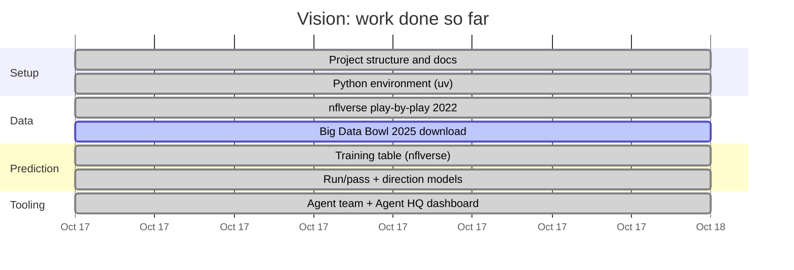

# Vision: Progress Log

This file explains what has been built so far, why, and how it fits together. It is updated at the end of every work session. The chart only shows work that is done or in progress. There are no future plans in it.



---

## 2026-10-17: First play predictor (run/pass)

### What was done
We built the first working piece of the `prediction` stage. Given only what you could know **before the snap** (down, distance, clock, score, and the offense's formation), it guesses run or pass and says how sure it is. On games it never saw during training, it's right **75.2%** of the time. Always guessing "pass" gets you 59.4%. Its confidence is also honest: when it says "85% pass", it's right about 85% of the time.

The pieces:
- `pipeline/prediction/dataset.py` + `scripts/build_dataset.py`: build the training table, `data/processed/plays_2022.parquet`.
- `pipeline/prediction/model.py` + `scripts/train_prediction.py`: train the models, evaluate them, and save `models/run_pass_2022.joblib`, `models/direction_2022.joblib`, and every number below to `models/metrics_2022.json`.
- `tests/test_prediction_dataset.py`, `tests/test_prediction_model.py`: check that the filters work, that no after-the-snap column sneaks in, and that no game lands in both the training and test sets.

**The training table.** Two free nflverse files for 2022, no signup needed:
- **play-by-play**: one row per play, with the situation (down, distance, clock, score) and the outcome (run/pass, direction).
- **participation**: formation (`SHOTGUN`, `I_FORM`, `EMPTY`…), personnel (for example "1 RB, 1 TE, 3 WR"), and how many defenders are in the box. Human charters (FTN) and the NFL's Next Gen Stats recorded these.

We kept only real offensive snaps:

| Step | Plays left |
|---|---|
| All rows in the 2022 play-by-play | 49,434 |
| Only runs and dropbacks (drops kickoffs, punts, timeouts…) | 36,870 |
| Drop plays wiped out by a penalty | 35,430 |
| Drop 2-point tries | 35,304 |
| Drop aborted plays (botched snaps) | 35,193 |

Every one of the 35,193 plays matched a participation row (100% join), and 99.9% have a formation. 60.4% are passes. The label is the **play call**, not the result. A QB who drops back and then scrambles counts as a pass, because a pass was the plan.

**The results** (test set: weeks 15–22, 9,431 plays):

| Model | What it sees | Accuracy | Log loss (lower is better) |
|---|---|---|---|
| A. Always "pass" | nothing | 59.4% | 0.676 |
| B. Situation only | down, distance, field position, clock, score, timeouts | 70.7% | 0.540 |
| C. Situation + formation | B, plus formation, shotgun, personnel, defenders in the box | **75.2%** | **0.491** |

How to read the gaps:
- **A → B (+11.3 points): the game situation.** 3rd and 12 is almost always a pass. 1st and goal from the 2 is often a run. Down and distance alone carry a lot of information.
- **B → C (+4.5 points): what you can see on the field.** This is the part a camera can supply. Across the season, `EMPTY` (no running back in the backfield) was a pass **96.9%** of the time, and `I_FORM` (two backs stacked behind the QB) only **27.5%**. The formation gives away the play call.

We also tried **direction** (left / middle / right). It doesn't work yet. See the limitations below.

### Why it was needed
The prediction stage is the end goal, and it is the one stage we can train without any video. If the predictor couldn't beat "always pass" even with perfect, human-labeled formations, there would be no point building the vision stages to feed it. Now we know formation is worth about 4.5 points of accuracy on top of the game situation, and that the confidence numbers can be trusted.

### How it fits the bigger pipeline
This is stage 6, `prediction`, trained without a single frame of video. In the app, its inputs will have to come from somewhere else:

| Input | Examples | Where it comes from today | Where it would come from in the app |
|---|---|---|---|
| Game situation | down, distance, yard line, clock, score, timeouts | nflverse play-by-play | **Open question:** reading the on-screen score box (the "scorebug"), or the user types it in |
| Alignment | formation, shotgun, personnel counts, defenders in the box, players on the field | Human charters (FTN / NGS) | Vision stages 1–5: detect → track → field coordinates → formation |

So the vision stages now have a concrete target: produce something like `offense_formation = SHOTGUN, defenders_in_box = 6` from video, and this model does the rest.

### Concepts worth understanding

**1. Data leakage: never let the model peek at the answer.**
The participation file also has columns like `number_of_pass_rushers`, `time_to_throw`, and the routes receivers ran. They describe what happened **after** the snap. Suppose we included `time_to_throw`. It only has a value when the QB actually throws. The model would learn one rule, "if `time_to_throw` has a value, it's a pass", and score close to 100% on the test set. Then you'd point the app at a real game, and before the snap that column doesn't exist yet. The model would be useless. A leaky model looks amazing in testing and fails the moment you use it. `dataset.py` only keeps columns you can know before the snap, and `test_build_dataset_filters_and_no_leaks` fails if any banned column shows up.

**2. Split train and test by time, not at random.**
We train on weeks 1–14 (25,762 plays) and test on weeks 15–22 (9,431 plays, including the playoffs). The app will always be predicting games that haven't happened yet, so the test should look like that too. With a random split, the model could train on some of a Week 16 Chiefs game and be tested on other plays from that same game. Same teams, same weather, same game plan. That flatters the score. Splitting by week also keeps each game entirely on one side, which `test_time_split_keeps_games_apart` checks.

**3. Baselines: the number to beat isn't 50%.**
Run/pass looks like a coin flip, but NFL teams pass more than they run. In the test weeks, 59.4% of plays were passes, so a "model" that always says pass gets 59.4% with zero intelligence. Any real model has to beat that. Compare against the dumbest reasonable strategy, not against random chance. (ECE parallel: you judge a detector against the noise floor, not against zero.)

**4. Gradient-boosted trees: lots of small trees, each fixing the last one's mistakes.**
A decision tree is a flowchart of yes/no questions. One small tree is a weak model. Boosting builds them one after another:
- Tree 1 might ask "is the formation `EMPTY`?" If yes, predict a high pass probability (96.9% of those plays are passes). If no, ask "is it 3rd down?", and so on.
- Tree 2 doesn't start over. It looks at where tree 1 was **wrong**, for example a group of short-yardage plays that tree 1 called passes when teams actually ran, and learns a correction for that group.
- Tree 3 corrects what's still wrong after trees 1 and 2, and so on. The final answer is the sum of all the corrections.

We used scikit-learn's `HistGradientBoostingClassifier`. It handles missing values and the formation category directly. It also uses **early stopping**: it holds back 10% of the training plays and stops adding trees once the score on those plays stops improving, so it doesn't just memorize the training set.

**5. Calibration: does "75% sure" really mean 75%?**
Group the test plays by how confident the model was, then check how often it was right in each group:

| Model's confidence | Plays | Average confidence | Actually right |
|---|---|---|---|
| 50–60% | 1,996 | 55.1% | 55.5% |
| 60–70% | 2,077 | 64.8% | 65.9% |
| 70–80% | 1,744 | 74.9% | 75.1% |
| 80–90% | 1,319 | 85.1% | 84.8% |
| 90–100% | 2,295 | 95.4% | 95.5% |

Every row is within about 1 point. When the model says "85% pass", it's right about 85% of the time. That's what we want, because the app's whole promise is a best guess **plus a confidence level**. A model that says "95%" but is right only 70% of the time would mislead the user.

We also tried **isotonic calibration**, which learns a correction curve on separate weeks (train on weeks 1–10, fit the curve on 11–14). It made things slightly worse (log loss 0.497 → 0.505), so we didn't use it. The model was already calibrated. The extra step only added noise.

**6. Log loss vs accuracy: punishing confident mistakes.**
Accuracy only asks "was the guess right?" Log loss also asks "how sure were you?" For each play, the cost is −ln(the probability you gave to what actually happened). Say the play is a pass:

| Model said P(pass) = | Cost |
|---|---|
| 0.9 (confident, right) | −ln 0.9 = 0.11 |
| 0.6 (unsure, right) | −ln 0.6 = 0.51 |
| 0.1 (confident, wrong) | −ln 0.1 = 2.30 |

The confident wrong answer costs about 20 times more than the confident right one. Both 0.6 and 0.9 count as "correct" for accuracy, but log loss rewards the 0.9. Since the app reports confidence, this is the metric that matters most. (ECE parallel: model A's 0.676 is almost exactly the entropy, in nats, of a 59/41 coin. With no information you can't beat the source entropy. Every drop below it is information the features provide.)

**7. Permutation importance: which inputs matter?**
Take the test set, shuffle one column (say, randomly reassign the formations between plays), and see how much worse the model gets. If it barely changes, the model wasn't relying on that column. If it collapses, that column was doing the work. Increase in log loss when each column is shuffled:

| Feature | Log loss increase |
|---|---|
| `offense_formation` | 0.145 |
| `down` | 0.059 |
| `ydstogo` (yards to go) | 0.048 |
| `defenders_in_box` | 0.016 |
| `score_differential` | 0.013 |

Formation matters most by a wide margin, and it's exactly the kind of thing vision can provide. Personnel counts (`off_wr`, `off_te`…) barely register, likely because the formation already tells the model most of the same thing.

### Honest limitations
- **Direction has no skill yet.** On 8,814 test plays with a known direction, the model is right 40.1% of the time. "Guess the most common direction for runs, and the most common for passes" gets 40.2%. So it learned nothing useful. That makes sense: whether a play goes left or right depends on which side the formation is strong to (where the tight end and extra receivers line up), and our inputs only say "`SHOTGUN`", not which side anything is on. Real (x, y) field positions, the exact output of the vision stages (or Big Data Bowl tracking data), should help.
- **One season only.** 2022 only. Teams and trends shift from year to year, so more seasons would make it sturdier.
- **The situation inputs aren't visible to the player detector.** Down, distance, clock, and score don't come from player positions. The app will need to read the scorebug, or ask the user. That's an open design question, not a decision.
- **Formation labels come from humans here.** In this dataset, people charted every formation. In the app, the vision stages will have to produce them, and they'll make mistakes. Expect accuracy to drop somewhat once the formation is a guess instead of a known fact.

### Who did the work: an agent team
This session's work was split across a small team of AI subagents, each with one narrow job, led by **Coach**: **Data Wrangler** built the training table, **Modeler** trained and evaluated the models, **Teacher** wrote this entry, and **Game Dev** built `tools/agent-hq/`, a dashboard that shows the agents working live as a little video game. Narrow jobs keep each agent focused, the same reason the pipeline is split into stages.

---

## 2026-10-17: Python environment and first data

### What was done
- Set up the Python environment with **uv**, pinned to Python 3.12. Packages so far: `kaggle` (downloads datasets), `pandas` (tables), `pyarrow` (reads `.parquet` files).
- Downloaded **nflverse play-by-play for the 2022 season** (49,434 plays) into `data/raw/nflverse/`.
- Wrote `scripts/download_data.sh`, one command that re-downloads all the raw data.
- **Big Data Bowl 2025 is not downloaded yet.** It needs your Kaggle account (steps below).

### Why it was needed
We're building the prediction stage first because it has free labels. Two datasets cover the same 2022 games:

| Dataset | What it gives us | Role |
|---|---|---|
| Big Data Bowl 2025 (Kaggle) | Every player's (x, y) position 10 times per second, including **before the snap** | The **input**: what the formation looked like |
| nflverse play-by-play | What happened on every play: run/pass, `run_location` (left/middle/right), `run_gap`, `pass_location`, `air_yards` (how far the ball was thrown) | The **labels**: the answers the model learns to predict |

Example: in one play the tracking data shows a shotgun formation with 3 receivers to the right. The play-by-play row says `play_type = pass`, `pass_location = right`, `air_yards = 14`. Join the two by game and play ID and you have one training example. With about 8,000 such plays, no hand-labeling is needed.

### Concepts worth understanding

**1. uv and the lockfile.**
`pyproject.toml` lists the packages we asked for, such as "pandas 3 or newer". `uv.lock` records the *exact* version of every package that got installed, including packages pulled in by other packages. That makes the environment reproducible: same lockfile, same environment, on any machine. To run anything, use `uv run <command>`. It uses the project's environment automatically, so there's no "activate the venv" step.

**2. Why Python 3.12 and not your system's 3.14?**
Libraries with compiled code, like PyTorch and coremltools, publish builds for each Python version, and they usually trail new Python releases by months. 3.12 is the safe choice everything supports.

**3. Parquet vs CSV.**
Parquet stores a table column by column, compressed. The 2022 play-by-play has 372 columns. As CSV it would be several times bigger and slower to load. Parquet also remembers each column's type, so numbers come back as numbers and not text.

### What you need to do (Kaggle)
1. Create an account at kaggle.com, or sign in.
2. Open kaggle.com/competitions/nfl-big-data-bowl-2025, go to the **Data** tab, and click **"I Understand and Accept"** on the rules. The download is refused until you do this.
3. Go to kaggle.com/settings, find **API**, and click **Create New Token**. Save the downloaded `kaggle.json` to `~/.kaggle/kaggle.json`, then run `chmod 600 ~/.kaggle/kaggle.json` so only you can read it.
4. Run `bash scripts/download_data.sh` (or ask Claude to run it).

---

## 2026-10-17: Project setup

### What was done
- Created the folder structure, a short README in every top-level folder, a root README, a `.gitignore`, `CLAUDE.md`, and this file.
- Ran `git init`, which turned the folder into a git repository. Nothing has been committed yet.
- No code was written on purpose. This step only decides **where things go** and **why**.

### Why it was needed
This project has two very different halves: a Python ML pipeline that runs on your Mac, and a Swift app that runs on your iPhone. They are connected by trained model files. Without a clear layout, data files, model weights, notebooks, and app code get mixed together fast, and it becomes hard to tell what is real code, what is an experiment, and what can be regenerated.

### How it fits the bigger pipeline
The folders follow the path the data takes:

```
data/  →  pipeline/ (train)  →  models/  →  pipeline/export  →  coreml/  →  app/
raw       Python code           .pt         coremltools         .mlpackage   iPhone
```

Inside `pipeline/`, each folder is one stage of the vision → prediction chain:

| Order | Folder | Question it answers |
|---|---|---|
| 1 | `view_classification` | What kind of shot is this? (overhead, broadcast, sideline, phone at a TV…) |
| 2 | `detection` | Where are the players and the ball in this frame? |
| 3 | `tracking` | Which box in this frame is the same player as in the last frame? |
| 4 | `field_mapping` | Where is each player standing on the real field, in yards? |
| 5 | `formation` | What formation is the offense in? |
| 6 | `prediction` | What play is coming, and how sure are we? |
| (7) | `export` | Convert trained models into Core ML for the iPhone |

### Concepts worth understanding

**1. A pipeline is like a signal chain.**
You've seen this in ECE: an antenna feeds a filter, which feeds a demodulator, which feeds a decoder. Each block has one job, a defined input, and a defined output. You can test each block alone. Vision works the same way. The detector doesn't need to know anything about football plays. It just outputs boxes. The predictor doesn't need to know anything about pixels. It just takes player positions. Keeping the stages in separate folders keeps those boundaries clean.

**2. The most important decision: everything becomes field coordinates.**
A broadcast camera and an overhead camera produce very different-looking images. But if the left tackle is standing at the 35-yard line, 2 yards inside the left hash, that fact is the same from every camera.
So stages 1–4 have one job: turn *any* video into a list like this:

```
frame 120:  player 7 → (x = 35.0 yd, y = 21.3 yd)
            player 12 → (x = 33.5 yd, y = 26.6 yd)
            ball      → (x = 35.0 yd, y = 26.6 yd)
```

Stages 5–6 only ever see that list. That has two big benefits:
- The prediction model can be trained on the **NFL Big Data Bowl** dataset, which already gives player positions in exactly this format for thousands of real plays. You don't need to hand-label video to train the predictor.
- Adding a new camera angle only affects the vision half. The predictor doesn't change.

In ECE terms, it's like agreeing on a standard interface, such as a bus protocol, so either side can change without breaking the other.

**3. Homography (a preview, since it shapes the layout).**
A homography is a 3×3 matrix that maps points on one flat plane to another flat plane, seen from a different viewpoint. The field is flat, so if you can find at least 4 points whose real-world positions you know (for example where a yard line crosses a hash mark), you can compute the matrix and then convert *any* pixel on the field into yards. That's why `field_mapping` cares so much about yard lines and hash marks. They are the known reference points.

**4. Why some folders are "git-ignored."**
`.gitignore` tells git which files never to track. We ignore:
- **Datasets and videos**: huge files, and NFL footage is copyrighted. It must never end up in a repo.
- **Model weights and Core ML exports**: large binary files you can regenerate by re-running training or export.
- **Junk**: Python caches, Xcode build output, macOS `.DS_Store` files.
- **`.env`**: where secrets like API keys would go.

Example: you download a 2 GB game file into `data/raw/`. `git status` won't even show it, so you can't commit it by accident.

**5. Why the empty folders contain `.gitkeep`.**
Git tracks files, not folders. An empty folder disappears when someone clones the repo. A `.gitkeep` is an empty placeholder file. Its only job is to make git keep the folder.

**6. Why Core ML?**
Your Mac trains models with PyTorch, but iPhones run models fastest through Core ML, which can use the Neural Engine (Apple's dedicated ML hardware). `coremltools` converts between them. Running on-device means no server, no internet needed, and your video never leaves the phone.
