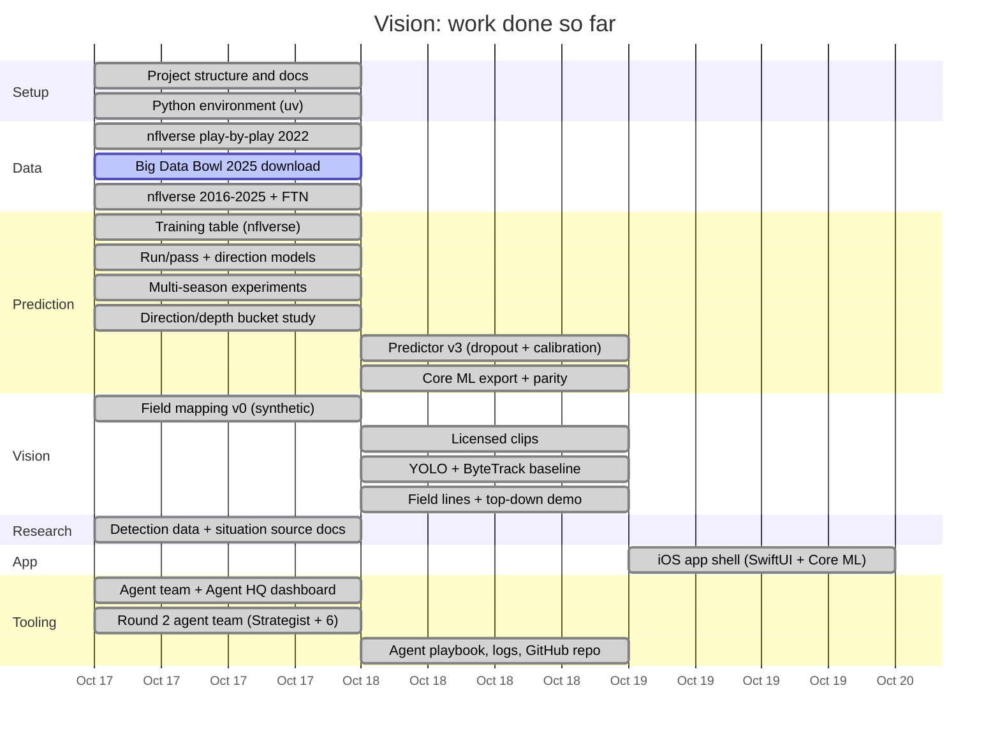

# Vision: Progress Log

This file explains what has been built so far, why, and how it fits together. It is updated at the end of every work session. The chart only shows work that is done or in progress. There are no future plans in it.



---

## 2026-10-19: The iPhone app shell

### What was done
The first iPhone app is built: a SwiftUI app in `app/` that runs the round 3 predictor on the device. You type in what you know, and it shows run vs pass, which way a run goes, and how deep a throw goes.
- **The project:** iOS 17+, iPhone only, portrait, Swift 5 mode. XcodeGen generates the Xcode project from `app/project.yml`. The generated `Vision.xcodeproj` is git-ignored.
- **What ships inside the app:** the three Core ML models (`run_pass`, `direction`, `depth`) and `predictor_schema.json`.
- **The input panel:** every control has a "?" state meaning "unknown". Personnel has quick presets: 11, 12, 21, 13, 10 and 22. The first digit is running backs and the second is tight ends, so "12" = 1 RB, 2 TE.
- **The result card:**
  - a strength label: **Lean** below 60%, **Likely** at 60–75%, **Strong** above 75%
  - bars for run direction (left/middle/right) and pass depth (≤0 / 1–9 / 10+ yd)
  - the note "About 12% of dropbacks end in a sack or scramble (no throw)"
- **Parity check:** 21 test scenarios, written by `scripts/make_app_fixtures.py`, from "nothing known" to "3rd & 9 shotgun empty". On macOS, the Swift predictor matches Python to within **1.1e-16** on all of them. **The same test then passed on the iPhone Simulator** (iPhone 18 Pro, iOS 27.1): 2 tests, 0 failures. The app also launched there, and with no inputs it shows 62% pass, the same as Python.

### Why it was needed
Everything so far has run in Python on the Mac. The goal is an on-device iPhone app, so this is the first time the model runs where it's meant to live. Building the shell now, with typed-in inputs, proves the Core ML side works before vision is connected. Later, vision fills in the same fields the user types today.

### How it fits
```
[ input panel (user) ]      ┐
[ vision stages (later) ]   ┴→ PlayInputs → PlayPredictor (3 Core ML models) → PlayPrediction → result card
```
`PlayPredictor` reads the feature order from `predictor_schema.json`. It never hard-codes that order, so if the schema changes, the app follows.

### Concepts worth understanding

**1. The app bundle.**
An iOS app is a folder (`Vision.app`) holding the compiled code plus every file it needs at run time. Xcode compiles each `.mlmodel` into a `.mlmodelc` folder inside the bundle, and `predictor_schema.json` is copied in as-is. The app loads them with `Bundle.main.url(forResource:)`, much like reading a file from the program's own install folder. That's why the app works offline: everything it needs travels with it.

**2. MLMultiArray, and why "unknown" is NaN, not 0.**
Core ML takes the inputs as an `MLMultiArray`: a typed array of numbers, here 28 doubles in the schema's order. A missing input must be **NaN**, because 0 is a real value. `down = 0` doesn't mean "I don't know the down". It would be read as an actual input the model never saw in training. The trees learned a separate branch for missing values, and only NaN takes that branch. Example: if you leave the formation at "?", all three formation columns become NaN. Choose "shotgun" and they become 1, 0, 0.
- **Derived inputs** are filled in only when everything they depend on is known. For example, "game seconds remaining" is computed only when both the quarter and the quarter clock are set. Otherwise it stays NaN.

**3. Contract-first parallel work.**
Before anyone wrote code, Coach defined three Swift types:
- `PlayInputs`: what's known, with `nil` meaning unknown
- `PlayPrediction`: the three sets of probabilities
- `PlayPredictor`: the object that turns one into the other

That let three agents build at the same time without waiting for each other. The screens could be built against `PlayPrediction` before the predictor existed. (ECE parallel: agree on the bus protocol first, then the CPU team and the peripheral team can design their boards separately and still plug together.)

**4. XcodeGen vs a hand-edited Xcode project.**
An `.xcodeproj` is a large, machine-written file. Two people (or two agents) editing it at once produce merge conflicts that are painful to fix. With XcodeGen, the source of truth is about 50 readable lines of `project.yml` (targets, iOS version, which files to bundle). `xcodegen generate` rebuilds the project from it. So only the short file is committed, and the generated project can always be thrown away and rebuilt.

**5. Signing: free Apple ID vs a paid account.**
iPhones only run apps signed by a known developer.
- **Free Apple ID:** you can install on your own phone from Xcode, but the signature **expires after 7 days**. After that, you just run it from Xcode again.
- **Paid Apple Developer account (yearly fee):** gives longer-lived signatures, TestFlight, and the App Store.

For personal use, the free route is enough. `DEVELOPMENT_TEAM` is left blank in `project.yml`, so you pick your own Team in Xcode. `app/README.md` has the steps, including turning on Developer Mode on the phone.

### Who did the work
Three agents built it in parallel, against the contract above:
- **App Architect:** the project spec and the app entry point.
- **Model Bridge:** the Swift predictor (schema-driven feature order, NaN for unknowns, derived inputs) and the 21 parity fixtures.
- **Game Dev:** the input panel and the result card.

### Honest limitations
- **Inputs are typed in by hand.** No camera or video yet.
- **Parity is confirmed on macOS and the iPhone Simulator**, but the app hasn't been run on a real phone yet.
- **The test scenarios are hand-picked**, not a sweep of real plays.

---

## 2026-10-18: App-ready predictor, Core ML export, first real-footage vision

### What was done
1. **Predictor v3**: one model that handles any mix of missing inputs, plus two new heads: direction (runs only) and depth (throws only). It was trained on 2016–2023 (273,298 plays), calibrated on 2024 (34,788), and tested on 2025 (34,413). Results are in `models/metrics_v3.json`.
2. **Core ML export**: all three heads now exist as Core ML models in `coreml/`, and on our test plays they give the same answers as the Python models.
3. **Three openly licensed game clips**: high-school games from the Internet Archive. Two are sideline-elevated shots (CC0), and one is a high, wide shot (Public Domain Mark; this is the 480p one). There's no NFL footage, and no video is committed. Details are in `docs/research/clips.md` and `docs/clips_manifest.json`.
4. **First vision on real footage**: YOLO detection plus ByteTrack tracking, field-line detection, and a demo that draws the players on a top-down field.

**One model, every input pattern** (2025 test):

| Inputs available | Accuracy |
|---|---|
| Everything | 76.2% |
| No situation (camera only) | 74.9% |
| Down & distance + camera | 75.7% |
| Situation only (vision failed) | 70.7% |
| Nothing | 60.4% |

Each row is within about 0.25 points of a separate model trained only for that pattern. Training with dropout costs 0.07 points on clean data (76.27% → 76.20%).

**The heads** (2025):

| Head | Model | Base rate |
|---|---|---|
| Direction, runs (left/middle/right) | 40.2% | 36.4% |
| Depth, throws (≤0 / 1–9 / 10+ air yards) | 48.6% | 45.7% |

**Vision on the clips:**
- **Spotter (YOLO26s + ByteTrack, 1280 px input, on the Mac's GPU):**
  - Runs at 24–27 frames per second and finds 23–45 people per frame.
  - About half of those people are on the sideline, not in the game.
  - It finds the ball in only 2–13% of frames.
  - Player IDs break apart in pile-ups and when the camera pans.
- **Field Surveyor:**
  - On the wincam clip, 8% of frames could be mapped to the field (median error at the landmarks 0.38 yd).
  - On the Belmont clips, 0% could be mapped (see concept 6).
  - In a synthetic test, 95% of points land within 0.17 yd.

### Why it was needed
In the app, inputs will often be missing: no scorebug, a formation vision couldn't read, a user who skipped the down. Before v3, every missing pattern would have needed its own model. Core ML is the format the iPhone runs. Real clips are the first test of the vision half against something other than synthetic cameras.

### How it fits
```
clip → YOLO (people, ball) → ByteTrack (IDs) → field lines → homography → [formation: not built] → predictor v3 (Core ML)
```
`coreml/predictor_schema.json` is the contract between the halves. It lists the 28 inputs in order, and for each one whether it comes from the **user** (down, distance, score…), is **derived** (game clock from quarter clock), or comes from **vision** (formation family, personnel, box count, hash). Unknown inputs must be NaN, never 0.

### Concepts worth understanding

**1. Input dropout: train on the gaps you'll see in use.**
During training, inputs were randomly blanked: the formation on 15% of rows, the scoreboard on 40%, the whole situation on 25%, all vision inputs on 10%. The trees learn what to do when a value is missing, so one model covers every row of the table above. Example: on a Belmont clip with no down and distance on the scorebug, the app sends NaN, and the model falls back to what the formation says.

**2. Wrong vs blank.**
Corrupt the formation on 30% of 2025 plays:
- **Blank** (vision says "unknown"): accuracy drops 76.2% → 75.4%, a 0.8-point loss.
- **Misread** (vision guesses wrong): it drops to 71.8%, a 4.4-point loss.

A wrong input costs more than five times as much as an honest blank. So the vision stages should report "unknown" when they're unsure.

**3. Platt vs temperature calibration.**
- **Platt scaling** fits two numbers, a slope and an offset, on the model's log-odds, using held-out data (here, 2024). It was fit for run/pass, but in a backtest it barely changed anything (log loss 0.4665 → 0.4663), and on 2025 it made results worse. Run/pass ships uncalibrated. Its bins are already within about 1 point (for example, plays at about 75% confidence were right 74.3% of the time).
- **Temperature scaling** divides all the scores by one number, T, before turning them into probabilities. T > 1 softens overconfident guesses. Direction got T = 1.24, which lowered its log loss from 1.076 to 1.073. Depth got T = 1.00, which means it was already calibrated.

**4. Conditional heads.**
Direction is only predicted for runs, and depth only for throws. The app shows "if it's a run: probably left" next to the run/pass probability. Each head answers a question that only makes sense in one branch, the same way you'd only decode a payload after the header says what type it is.

**5. Why tree models export exactly.**
A boosted-tree model is just a big network of comparators: "is `ydstogo` ≤ 6.5? go left, else right", and at the end, add up the leaf values. Our own converter (`pipeline/export/hgb_to_coreml.py`) copies every threshold and leaf into Core ML's tree format. We needed it because the official sklearn converter is disabled for sklearn 1.9. Missing values needed care. Using `LessThanEqual` with `missing_value_tracks_true_child` sends a NaN down the same branch sklearn learned for it. Result:
- On 2,000 plays from 2025, the largest difference from Python is 3.3e-16, which is floating-point rounding. The top pick (argmax) matches 100% of the time.
- File sizes: run/pass 124 KB, direction and depth 394 KB each.
- About 0.02 ms per prediction.

**6. Detection vs tracking.**
Detection answers "where are the people in **this** frame?" Tracking answers "is box 7 now the same player as box 7 a moment ago?" ByteTrack matches boxes between frames by predicted motion and overlap. In a pile-up, boxes merge and split, and the tracker can hand a player a new ID. That's an **ID switch**, or fragmentation. It's harmless for one snapshot, but it matters if you follow a player through a play.

**7. Hough lines and vanishing points.**
The Hough transform finds straight lines by letting every edge pixel vote for every line it could lie on. The lines with the most votes win. Yard lines are parallel on the field, but in the image they all point toward one **vanishing point**, like rails meeting at the horizon. The code relies on that geometry: steep lines are treated as yard lines, and flat rows as sidelines and hashes. On the Belmont clips the camera is so oblique that this split breaks down, so 0% of frames were mappable.

**8. Relative x.**
A yard line looks the same as every other yard line. Without reading the painted numbers, the map knows the players' spacing but not their absolute position. Every x might be off by an unknown multiple of 5 yd. Formation shape survives this. "At the 35" does not.

### Honest limitations
- **Core ML is tested on macOS only**, not yet on an iPhone.
- **The top-down demo isn't a measurement.** It maps frame 103 with a homography, then carries that map to later frames by following how the grass moves. Drift was never measured. Treat it as a picture, not as data.
- **Mappable frames are rare**: 8% on one clip and 0% on the other two. Distance along the field is only relative.
- **Detection doesn't separate players from sideline people, and it rarely sees the ball.**
- **The clips are high school**, not NFL, and the wincam's public-domain mark was applied by the uploader, not the producer.
- **Direction and depth beat their base rates by only about 3–4 points.**

---

## 2026-10-18: Agent playbook, logs, and the GitHub repo

### What was done
- **`AGENT_TEAM.md`**: a portable playbook you can drop into any project. It tells Claude to build a dashboard themed on *that* project first, then run a Strategist and a team of labeled agents, with the bench, phases and logs exactly like here.
- **Logs**: every status update an agent sends is now also appended to `tools/agent-hq/logs/activity-<date>.jsonl`. After each round the lead writes a one-page summary in `tools/agent-hq/logs/rounds/`.
- **GitHub**: the project now lives in a private repo, `nicolasman7/Vision`. Instead of one giant commit, the history has one commit per agent per round, dated when the work actually happened.

### Concepts worth understanding

**1. A commit is a snapshot, and its date is just metadata.**
Git stores each commit as "the full state of the tracked files, plus who, when, and why." The date is a field you can set (`GIT_AUTHOR_DATE`). So we rebuilt each step's snapshot (for example, "Round 1 · Modeler" contains exactly the files Modeler wrote) and stamped it with the time on the files. Where an old version of a file no longer existed (early `CLAUDE.md` and `PROGRESS.md`), it was rebuilt from the session record. The round 1 snapshot was re-run to make sure its tests still pass.

**2. Why commit per agent?**
The same reason you'd keep separate schematic revisions per subsystem: if something breaks later, `git log` tells you which agent changed which file and when, and `git revert` can undo just that piece.

**3. What gets pushed and what doesn't.**
`.gitignore` keeps out data (copyrighted and huge), trained models (regenerable), the live dashboard status (changes every second) and secrets. The largest file in the whole repo history is the 200 KB lockfile.

---

## 2026-10-18: Ten seasons, field mapping, and decision research

_The work ran overnight, from the evening of Oct 17 into Oct 18._

### What was done
Four things happened in parallel:

1. **Ten seasons of data.** The training table grew from 2022 only to **2016–2025: 342,499 plays, 45 columns**, now including FTN's hand-charted pre-snap details (available 2022+). As a sanity check, the 2022 slice is still exactly 35,193 plays, and last session's model C still scores 75.23%.
2. **Five experiments on the run/pass model** (E1–E5, `scripts/experiments_prediction.py`, results in `models/metrics_multiseason.json`):

| # | Question | Answer |
|---|---|---|
| E1 | Do older seasons help? | Barely. On the same 2022 test, training on 2019–2022 (128,543 plays) instead of just 2022 (25,762) moves accuracy 75.23% → 75.35%, log loss 0.491 → 0.487. |
| E2 | Does it hold up on the newest season? | Yes. Trained on 2016–2024, tested on all of 2025: **76.2%**, vs 60.4% for always-pass and 71.1% for situation only. |
| E3 | Do FTN's extra pre-snap columns (hash, QB spot, backfield count) help? | Essentially no: 76.16% → 76.25%, log loss 0.483 → 0.482. |
| E4 | How much does the scoreboard (down, distance, clock, score) matter? | Alignment only: 75.0%. Adding the full situation: 76.2%. It mostly sharpens confidence (log loss 0.527 → 0.480). |
| E5 | What if vision misreads the formation? | Each 10% of misreads costs about 1.5 points. A box count off by one costs nothing. |

The saved model is the E2 one (`models/run_pass_multiseason.joblib`, trained on 2016–2024). It uses `formation_family` instead of the old 7-label formation, so it still works on 2023+ data (see concept 1).

3. **Field mapping v0, the first vision code.** `pipeline/field_mapping/field.py` holds the field's geometry in yards, from the NFL rulebook. For example, the hash marks are 70 ft 9 in from each sideline, which is 23.583 yd. `homography.py` fits the image-to-field map. It was tested only on **synthetic cameras** (perfect, made-up pinhole cameras where we know the true answer), with random noise added to the landmark pixels. Output from `scripts/field_mapping_error_budget.py`, in yards of error on the field:

| Camera view | 1 px noise: median / 95th percentile | 4 px noise: median / 95th percentile |
|---|---|---|
| All-22 | 0.017 / 0.043 | 0.086 / 0.252 |
| Broadcast | 0.014 / 0.040 | 0.070 / 0.218 |
| End zone | 0.019 / 0.051 | 0.085 / 0.279 |
| Broadcast, sideline landmarks only | unmappable | unmappable |

With 1 px of noise, a broadcast view puts 95% of points within 0.04 yd (about 1.5 in). Even at 4 px, the worst view stays under 0.28 yd (about 10 in). The math is not the bottleneck. Finding and naming the landmarks will be.

4. **Research for three decisions** you need to make (see "Decisions waiting for you" below).

### Why it was needed
- **One season was a small sample.** We needed to know whether more data helps (it barely does) and whether the model works on 2025, the season closest to what the app will see (it does).
- **Vision will make mistakes.** E5 turns "how accurate must formation reading be?" into numbers. That's a spec for the vision stages.
- **Field mapping is the bridge** between pixels and the predictor. Testing it on synthetic cameras with a known answer checks the math on its own, before messy real video gets involved. (ECE parallel: you characterize a filter with a clean test tone before connecting the real antenna.)
- **Three design questions were blocking the next steps.** Each needed evidence before you choose.

### How it fits the bigger pipeline
```
view_classification → detection → tracking → field_mapping → formation → prediction
      (none)          (research)    (none)    v0, synthetic     (none)    10 seasons
```
`prediction` is now trained and stress-tested. `field_mapping` exists in its first form. `detection` has a researched plan. E5 also gives the `formation` stage a target. Every 10% of misread formations costs about 1.5 points. Past about 20% misreads, a guess is no better than saying "unknown" (concept 5).

### Concepts worth understanding

**1. Label drift: the same column can change meaning between eras.**
In 2023 the NFL's participation data switched sources, and the labels changed:
- **Formation.** Through 2022 the labels were `SHOTGUN`, `SINGLEBACK`, `EMPTY`, `I_FORM`, `PISTOL`, `JUMBO`, `WILDCAT`. From 2023 they are only `SHOTGUN` / `UNDER CENTER` / `PISTOL`, which says where the **QB** stands, not the whole formation. `I_FORM` and `SINGLEBACK` both become "UNDER CENTER". So last session's fact "I_FORM is a pass only 27.5% of the time" can't be learned from 2023+ data. The fix is `formation_family` (shotgun / under_center / pistol), which can be computed for every season, plus `is_empty`, taken from NGS's `EMPTY` label or from FTN's "0 players in the backfield".
- **Personnel.** "1 RB, 1 TE, 3 WR" became "1 C, 2 G, 1 QB, 1 RB, 2 T, 1 TE, 3 WR". The detailed positions are summed back into the old groups (C + G + T = OL; FB counts as RB). A trap: a quick text search for "OL" also matches "OLB" (outside linebacker). One agent's early claim about 2023 lineman counts came from exactly that mistake, and Data Wrangler caught it.
- **Box counts.** NGS and FTN both count "defenders in the box", but they agree on only 59% of 2022 plays. They define the box differently. So each source keeps its own column (`defenders_in_box` ≤2022, `box_part23` 2023+, `ftn_box`), left blank outside its era. (ECE parallel: two sensors with different calibrations go on separate channels. You don't average a reading in °C with one in °F.)
- **Sudden shifts are a warning sign.** Pistol was 9.3% of 2024 plays, vs 2–5% in other seasons. That could be a real trend or a charting change. Either way, check each season's label mix before trusting it.

**2. Leakage, again: FTN's tempting columns.**
FTN also charts play-action, screens, RPOs, blitzers, and more. All of these happen **after** the snap. Play-action is a fake handoff after the ball is snapped, and a play-action play is a pass by definition. Feed that column in, and the model learns "play-action means pass" and looks brilliant. Before the snap, though, the column doesn't exist yet. `dataset.py` reads only five whitelisted FTN columns (starting hash, QB location, backfield count, box count, motion), and `test_ftn_banned_columns_never_reach_output` fails if anything else gets in. Motion is borderline, because some motion happens right at the snap, so E3 tested it separately.

**3. Season-aware splits.**
Last session's split was "weeks 1–14 train, weeks 15+ test". With ten seasons, that rule would train on 2025 week 10 and test on 2016 week 16: learning from the future to predict the past. The new `season_split` picks a test period (for example "2025, all weeks") and trains only on what came **strictly before** it (2016–2024). The bucket study used "all earlier seasons plus 2022 weeks 1–14 → test on 2022 weeks 15–22".

**4. Ablation: take parts away and see what breaks.**
To learn what each input is worth, start from a stripped-down model and add pieces back one at a time (or remove them one at a time). E4 did this with the situation, on 2025:

| Model sees | Accuracy | Log loss |
|---|---|---|
| Alignment only (what a camera sees) | 75.0% | 0.527 |
| + down, distance | 75.7% | 0.503 |
| + yard line, goal-to-go | 75.8% | 0.498 |
| + score, quarter, clocks | 76.3% | 0.481 |
| + timeouts (full) | 76.2% | 0.480 |

The scoreboard is worth about 1 point of accuracy, but a big chunk of log loss. It makes the confidence sharper more than it changes the calls. Timeouts add nothing. (ECE parallel: pulling one component off a board to see what it was doing.) The full write-up is in `docs/research/situation_source.md`.

**5. Robustness: feed the model the mistakes vision will make.**
E5 took the 2019–2022 model and deliberately corrupted its 2022 test inputs:

| Formation misread rate | Accuracy | Log loss |
|---|---|---|
| 0% | 75.3% | 0.487 |
| 10% | 73.5% | 0.511 |
| 20% | 72.1% | 0.531 |
| 30% | 70.7% | 0.552 |
| Formation unknown (left blank) | 70.5% | 0.531 |

Box count off by ±1 on up to 30% of plays: accuracy stays at 75.3–75.4%, so it doesn't matter. The surprise is in the last two rows. At 30% misreads, accuracy is about the same as not knowing the formation at all, but log loss is **worse** (0.552 vs 0.531). A confidently wrong input does more damage than an honest blank. At 20% misreads, log loss already equals "unknown". This suggests the vision side should report "formation: unsure" rather than force a guess.

**6. Homography: one 3×3 matrix from pixels to yards.**
The field is a flat plane, and so is the image. Any camera view of a plane is a **projective transform**: a 3×3 matrix H with `[X, Y, 1] ∝ H · [u, v, 1]` (pixel `(u, v)` → field `(X, Y)` in yards). The overall scale of H doesn't matter, so it has 8 unknowns. Each landmark gives 2 equations (one for X, one for Y), so **4 landmarks** pin it down. Example: the left 35-yard line crossing the near hash is field point (45, 23.583) in our coordinates. Find where it appears in the image, and that's one landmark. More landmarks average out pixel noise. `homography.py` solves the least-squares version with an SVD (the solution is the singular vector with the smallest singular value). ECE parallel: this is camera calibration, the same math as rectifying a tilted photo of a document. A numeric detail: OpenCV computes in 32-bit floats, which left errors around a millionth of a yard, so Field Surveyor added a 64-bit refit.

**7. Why points along one line can't tell you how far across the field you are.**
In a tight broadcast shot you might see only where the yard lines cross the near sideline. Every one of those points has Y = 0. Now imagine stretching the field across its width, like pulling a rubber sheet away from that sideline: every sideline point stays exactly where it was. So those points can't tell a player 10 yd from the sideline apart from one 30 yd away. In degrees-of-freedom terms, points on one line fix only 5 of H's 8 unknowns, no matter how many there are. One extra point off the line adds 2, for a total of 7, still short of 8. It's a rank-deficient system: more measurements of the same kind don't raise the rank. `fit()` returns `None` here ("unmappable") instead of a confident wrong answer, which matches the app's "say how sure you are" rule.

**8. Log loss vs accuracy when the class mix shifts.**
Bucket Scout's runs-only direction model (left / middle / right):
- **2022 test:** the baseline always says "left" (the most common direction in training) and gets 38.9%. The model gets 41.2%: **+2.2 points**, log loss down **1.9%**.
- **2025 test:** late-season runs swung right (39.9% right, 35.3% left). The baseline still says "left", so it drops to 35.3%. The model gets 40.6%: **+5.3 points**, log loss down only **1.7%**.

Accuracy says the model got more than twice as good in 2025. Log loss says it got slightly *worse*. The accuracy "gain" was the baseline's bad luck, not the model's skill. Log loss scores the probabilities, so a shift in the test mix barely moves it. Each log-loss gap also comes with a standard error (about 0.0015–0.0045), and gaps under about 2 standard errors are noise.

### Honest limitations
- **Field mapping has only seen made-up cameras.** No lens distortion, no camera motion, and it is told which yard line each landmark belongs to. In real video, naming the lines is the hard part. Mislabel every line by one, and the whole map shifts 5 yd without any error being raised.
- **No real video has gone through anything yet.** Detection, tracking, and formation reading don't exist.
- **Direction still has essentially no skill.** The best option removes about 2% of the baseline's log loss. It most likely needs real (x, y) positions: which side the tight end is on, where the back is offset. Those come from Big Data Bowl data (still waiting on your Kaggle token) and, later, from the vision stages.
- **More data didn't fix it.** Ten seasons barely beat one. The limit is what the inputs say, not how many examples we have.
- **The 2025 model is slightly overconfident in the middle bins.** For example, when it says about 75%, it's right 72.7% of the time, and when it says about 85%, it's right 83.7%. That's 1–2 points, small but real.
- **E5's errors are random.** Real vision mistakes will follow patterns (look-alike formations get confused with each other more often), so treat E5 as a rough guide.

### Decisions waiting for you
Three research docs, each with one agent's recommendation. **These are recommendations, not decisions. You choose.**

1. **Detection training data**: [`docs/research/detection_datasets.md`](research/detection_datasets.md). Film Scout recommends starting with a COCO-pretrained YOLO11 (no labels, no accounts), then hand-labeling about 500 of your own frames with YOLO pre-labels (about 8–12 hours). Note that Ultralytics weights are AGPL-3.0: fine for personal use, but a problem if you ever ship the app.
2. **Where down, distance, clock, and score come from**: [`docs/research/situation_source.md`](research/situation_source.md). Film Scout recommends a two-tap input panel first and scorebug OCR as a pre-fill later. All-22, end-zone, and stands video have no scorebug. The doc now includes the E4 numbers above.
3. **Direction and depth targets**: [`docs/research/direction_depth_options.md`](research/direction_depth_options.md). Bucket Scout recommends **D2** for direction (runs only, left/middle/right) and **P3** for depth (air yards ≤0 / 1–9 / 10+, throws only). Sacks and scrambles (about 12% of dropbacks in 2025) would be shown as a plain base-rate note.

### Who did the work
Coach led a second team. **Strategist** planned it. It checked what data exists (participation 2016–2025, FTN 2022–2025), spotted the 2023 label change and the broken split, designed the plan, and was then benched. **Data Wrangler** built the 10-season table. **Modeler** ran E1–E5. **Field Surveyor** wrote field mapping. **Film Scout** researched detection data and the situation source. **Bucket Scout** compared direction/depth options. **Teacher** wrote this entry. The agents also checked each other's work: Data Wrangler caught Strategist's "OL"/"OLB" mix-up.

---

## 2026-10-17: First play predictor (run/pass)

### What was done
We built the first working piece of the `prediction` stage. Given only what you could know **before the snap** (down, distance, clock, score, and the offense's formation), it guesses run or pass and says how sure it is. On games it never saw during training, it's right **75.2%** of the time. Always guessing "pass" gets you 59.4%. Its confidence is also honest: when it says "85% pass", it's right about 85% of the time.

The pieces:
- `pipeline/prediction/dataset.py` + `scripts/build_dataset.py`: build the training table, `data/processed/plays_2022.parquet`.
- `pipeline/prediction/model.py` + `scripts/train_prediction.py`: train the models, evaluate them, and save `models/run_pass_2022.joblib`, `models/direction_2022.joblib`, and every number below to `models/metrics_2022.json`.
- `tests/test_prediction_dataset.py`, `tests/test_prediction_model.py`: check that the filters work, that no after-the-snap column sneaks in, and that no game lands in both the training and test sets.

**The training table.** Two free nflverse files for 2022, no signup needed:
- **play-by-play**: one row per play, with the situation (down, distance, clock, score) and the outcome (run/pass, direction).
- **participation**: formation (`SHOTGUN`, `I_FORM`, `EMPTY`…), personnel (for example "1 RB, 1 TE, 3 WR"), and how many defenders are in the box. Human charters (FTN) and the NFL's Next Gen Stats recorded these.

We kept only real offensive snaps:

| Step | Plays left |
|---|---|
| All rows in the 2022 play-by-play | 49,434 |
| Only runs and dropbacks (drops kickoffs, punts, timeouts…) | 36,870 |
| Drop plays wiped out by a penalty | 35,430 |
| Drop 2-point tries | 35,304 |
| Drop aborted plays (botched snaps) | 35,193 |

Every one of the 35,193 plays matched a participation row (100% join), and 99.9% have a formation. 60.4% are passes. The label is the **play call**, not the result. A QB who drops back and then scrambles counts as a pass, because a pass was the plan.

**The results** (test set: weeks 15–22, 9,431 plays):

| Model | What it sees | Accuracy | Log loss (lower is better) |
|---|---|---|---|
| A. Always "pass" | nothing | 59.4% | 0.676 |
| B. Situation only | down, distance, field position, clock, score, timeouts | 70.7% | 0.540 |
| C. Situation + formation | B, plus formation, shotgun, personnel, defenders in the box | **75.2%** | **0.491** |

How to read the gaps:
- **A → B (+11.3 points): the game situation.** 3rd and 12 is almost always a pass. 1st and goal from the 2 is often a run. Down and distance alone carry a lot of information.
- **B → C (+4.5 points): what you can see on the field.** This is the part a camera can supply. Across the season, `EMPTY` (no running back in the backfield) was a pass **96.9%** of the time, and `I_FORM` (two backs stacked behind the QB) only **27.5%**. The formation gives away the play call.

We also tried **direction** (left / middle / right). It doesn't work yet. See the limitations below.

### Why it was needed
The prediction stage is the end goal, and it is the one stage we can train without any video. If the predictor couldn't beat "always pass" even with perfect, human-labeled formations, there would be no point building the vision stages to feed it. Now we know formation is worth about 4.5 points of accuracy on top of the game situation, and that the confidence numbers can be trusted.

### How it fits the bigger pipeline
This is stage 6, `prediction`, trained without a single frame of video. In the app, its inputs will have to come from somewhere else:

| Input | Examples | Where it comes from today | Where it would come from in the app |
|---|---|---|---|
| Game situation | down, distance, yard line, clock, score, timeouts | nflverse play-by-play | **Open question:** reading the on-screen score box (the "scorebug"), or the user types it in |
| Alignment | formation, shotgun, personnel counts, defenders in the box, players on the field | Human charters (FTN / NGS) | Vision stages 1–5: detect → track → field coordinates → formation |

So the vision stages now have a concrete target: produce something like `offense_formation = SHOTGUN, defenders_in_box = 6` from video, and this model does the rest.

### Concepts worth understanding

**1. Data leakage: never let the model peek at the answer.**
The participation file also has columns like `number_of_pass_rushers`, `time_to_throw`, and the routes receivers ran. They describe what happened **after** the snap. Suppose we included `time_to_throw`. It only has a value when the QB actually throws. The model would learn one rule, "if `time_to_throw` has a value, it's a pass", and score close to 100% on the test set. Then you'd point the app at a real game, and before the snap that column doesn't exist yet. The model would be useless. A leaky model looks amazing in testing and fails the moment you use it. `dataset.py` only keeps columns you can know before the snap, and `test_build_dataset_filters_and_no_leaks` fails if any banned column shows up.

**2. Split train and test by time, not at random.**
We train on weeks 1–14 (25,762 plays) and test on weeks 15–22 (9,431 plays, including the playoffs). The app will always be predicting games that haven't happened yet, so the test should look like that too. With a random split, the model could train on some of a Week 16 Chiefs game and be tested on other plays from that same game. Same teams, same weather, same game plan. That flatters the score. Splitting by week also keeps each game entirely on one side, which `test_time_split_keeps_games_apart` checks.

**3. Baselines: the number to beat isn't 50%.**
Run/pass looks like a coin flip, but NFL teams pass more than they run. In the test weeks, 59.4% of plays were passes, so a "model" that always says pass gets 59.4% with zero intelligence. Any real model has to beat that. Compare against the dumbest reasonable strategy, not against random chance. (ECE parallel: you judge a detector against the noise floor, not against zero.)

**4. Gradient-boosted trees: lots of small trees, each fixing the last one's mistakes.**
A decision tree is a flowchart of yes/no questions. One small tree is a weak model. Boosting builds them one after another:
- Tree 1 might ask "is the formation `EMPTY`?" If yes, predict a high pass probability (96.9% of those plays are passes). If no, ask "is it 3rd down?", and so on.
- Tree 2 doesn't start over. It looks at where tree 1 was **wrong**, for example a group of short-yardage plays that tree 1 called passes when teams actually ran, and learns a correction for that group.
- Tree 3 corrects what's still wrong after trees 1 and 2, and so on. The final answer is the sum of all the corrections.

We used scikit-learn's `HistGradientBoostingClassifier`. It handles missing values and the formation category directly. It also uses **early stopping**: it holds back 10% of the training plays and stops adding trees once the score on those plays stops improving, so it doesn't just memorize the training set.

**5. Calibration: does "75% sure" really mean 75%?**
Group the test plays by how confident the model was, then check how often it was right in each group:

| Model's confidence | Plays | Average confidence | Actually right |
|---|---|---|---|
| 50–60% | 1,996 | 55.1% | 55.5% |
| 60–70% | 2,077 | 64.8% | 65.9% |
| 70–80% | 1,744 | 74.9% | 75.1% |
| 80–90% | 1,319 | 85.1% | 84.8% |
| 90–100% | 2,295 | 95.4% | 95.5% |

Every row is within about 1 point. When the model says "85% pass", it's right about 85% of the time. That's what we want, because the app's whole promise is a best guess **plus a confidence level**. A model that says "95%" but is right only 70% of the time would mislead the user.

We also tried **isotonic calibration**, which learns a correction curve on separate weeks (train on weeks 1–10, fit the curve on 11–14). It made things slightly worse (log loss 0.497 → 0.505), so we didn't use it. The model was already calibrated. The extra step only added noise.

**6. Log loss vs accuracy: punishing confident mistakes.**
Accuracy only asks "was the guess right?" Log loss also asks "how sure were you?" For each play, the cost is −ln(the probability you gave to what actually happened). Say the play is a pass:

| Model said P(pass) = | Cost |
|---|---|
| 0.9 (confident, right) | −ln 0.9 = 0.11 |
| 0.6 (unsure, right) | −ln 0.6 = 0.51 |
| 0.1 (confident, wrong) | −ln 0.1 = 2.30 |

The confident wrong answer costs about 20 times more than the confident right one. Both 0.6 and 0.9 count as "correct" for accuracy, but log loss rewards the 0.9. Since the app reports confidence, this is the metric that matters most. (ECE parallel: model A's 0.676 is almost exactly the entropy, in nats, of a 59/41 coin. With no information you can't beat the source entropy. Every drop below it is information the features provide.)

**7. Permutation importance: which inputs matter?**
Take the test set, shuffle one column (say, randomly reassign the formations between plays), and see how much worse the model gets. If it barely changes, the model wasn't relying on that column. If it collapses, that column was doing the work. Increase in log loss when each column is shuffled:

| Feature | Log loss increase |
|---|---|
| `offense_formation` | 0.145 |
| `down` | 0.059 |
| `ydstogo` (yards to go) | 0.048 |
| `defenders_in_box` | 0.016 |
| `score_differential` | 0.013 |

Formation matters most by a wide margin, and it's exactly the kind of thing vision can provide. Personnel counts (`off_wr`, `off_te`…) barely register, likely because the formation already tells the model most of the same thing.

### Honest limitations
- **Direction has no skill yet.** On 8,814 test plays with a known direction, the model is right 40.1% of the time. "Guess the most common direction for runs, and the most common for passes" gets 40.2%. So it learned nothing useful. That makes sense: whether a play goes left or right depends on which side the formation is strong to (where the tight end and extra receivers line up), and our inputs only say "`SHOTGUN`", not which side anything is on. Real (x, y) field positions, the exact output of the vision stages (or Big Data Bowl tracking data), should help.
- **One season only.** 2022 only. Teams and trends shift from year to year, so more seasons would make it sturdier.
- **The situation inputs aren't visible to the player detector.** Down, distance, clock, and score don't come from player positions. The app will need to read the scorebug, or ask the user. That's an open design question, not a decision.
- **Formation labels come from humans here.** In this dataset, people charted every formation. In the app, the vision stages will have to produce them, and they'll make mistakes. Expect accuracy to drop somewhat once the formation is a guess instead of a known fact.

### Who did the work: an agent team
This session's work was split across a small team of AI subagents, each with one narrow job, led by **Coach**: **Data Wrangler** built the training table, **Modeler** trained and evaluated the models, **Teacher** wrote this entry, and **Game Dev** built `tools/agent-hq/`, a dashboard that shows the agents working live as a little video game. Narrow jobs keep each agent focused, the same reason the pipeline is split into stages.

---

## 2026-10-17: Python environment and first data

### What was done
- Set up the Python environment with **uv**, pinned to Python 3.12. Packages so far: `kaggle` (downloads datasets), `pandas` (tables), `pyarrow` (reads `.parquet` files).
- Downloaded **nflverse play-by-play for the 2022 season** (49,434 plays) into `data/raw/nflverse/`.
- Wrote `scripts/download_data.sh`, one command that re-downloads all the raw data.
- **Big Data Bowl 2025 is not downloaded yet.** It needs your Kaggle account (steps below).

### Why it was needed
We're building the prediction stage first because it has free labels. Two datasets cover the same 2022 games:

| Dataset | What it gives us | Role |
|---|---|---|
| Big Data Bowl 2025 (Kaggle) | Every player's (x, y) position 10 times per second, including **before the snap** | The **input**: what the formation looked like |
| nflverse play-by-play | What happened on every play: run/pass, `run_location` (left/middle/right), `run_gap`, `pass_location`, `air_yards` (how far the ball was thrown) | The **labels**: the answers the model learns to predict |

Example: in one play the tracking data shows a shotgun formation with 3 receivers to the right. The play-by-play row says `play_type = pass`, `pass_location = right`, `air_yards = 14`. Join the two by game and play ID and you have one training example. With about 8,000 such plays, no hand-labeling is needed.

### Concepts worth understanding

**1. uv and the lockfile.**
`pyproject.toml` lists the packages we asked for, such as "pandas 3 or newer". `uv.lock` records the *exact* version of every package that got installed, including packages pulled in by other packages. That makes the environment reproducible: same lockfile, same environment, on any machine. To run anything, use `uv run <command>`. It uses the project's environment automatically, so there's no "activate the venv" step.

**2. Why Python 3.12 and not your system's 3.14?**
Libraries with compiled code, like PyTorch and coremltools, publish builds for each Python version, and they usually trail new Python releases by months. 3.12 is the safe choice everything supports.

**3. Parquet vs CSV.**
Parquet stores a table column by column, compressed. The 2022 play-by-play has 372 columns. As CSV it would be several times bigger and slower to load. Parquet also remembers each column's type, so numbers come back as numbers and not text.

### What you need to do (Kaggle)
1. Create an account at kaggle.com, or sign in.
2. Open kaggle.com/competitions/nfl-big-data-bowl-2025, go to the **Data** tab, and click **"I Understand and Accept"** on the rules. The download is refused until you do this.
3. Go to kaggle.com/settings, find **API**, and click **Create New Token**. Save the downloaded `kaggle.json` to `~/.kaggle/kaggle.json`, then run `chmod 600 ~/.kaggle/kaggle.json` so only you can read it.
4. Run `bash scripts/download_data.sh` (or ask Claude to run it).

---

## 2026-10-17: Project setup

### What was done
- Created the folder structure, a short README in every top-level folder, a root README, a `.gitignore`, `CLAUDE.md`, and this file.
- Ran `git init`, which turned the folder into a git repository. Nothing has been committed yet.
- No code was written on purpose. This step only decides **where things go** and **why**.

### Why it was needed
This project has two very different halves: a Python ML pipeline that runs on your Mac, and a Swift app that runs on your iPhone. They are connected by trained model files. Without a clear layout, data files, model weights, notebooks, and app code get mixed together fast, and it becomes hard to tell what is real code, what is an experiment, and what can be regenerated.

### How it fits the bigger pipeline
The folders follow the path the data takes:

```
data/  →  pipeline/ (train)  →  models/  →  pipeline/export  →  coreml/  →  app/
raw       Python code           .pt         coremltools         .mlpackage   iPhone
```

Inside `pipeline/`, each folder is one stage of the vision → prediction chain:

| Order | Folder | Question it answers |
|---|---|---|
| 1 | `view_classification` | What kind of shot is this? (overhead, broadcast, sideline, phone at a TV…) |
| 2 | `detection` | Where are the players and the ball in this frame? |
| 3 | `tracking` | Which box in this frame is the same player as in the last frame? |
| 4 | `field_mapping` | Where is each player standing on the real field, in yards? |
| 5 | `formation` | What formation is the offense in? |
| 6 | `prediction` | What play is coming, and how sure are we? |
| (7) | `export` | Convert trained models into Core ML for the iPhone |

### Concepts worth understanding

**1. A pipeline is like a signal chain.**
You've seen this in ECE: an antenna feeds a filter, which feeds a demodulator, which feeds a decoder. Each block has one job, a defined input, and a defined output. You can test each block alone. Vision works the same way. The detector doesn't need to know anything about football plays. It just outputs boxes. The predictor doesn't need to know anything about pixels. It just takes player positions. Keeping the stages in separate folders keeps those boundaries clean.

**2. The most important decision: everything becomes field coordinates.**
A broadcast camera and an overhead camera produce very different-looking images. But if the left tackle is standing at the 35-yard line, 2 yards inside the left hash, that fact is the same from every camera.
So stages 1–4 have one job: turn *any* video into a list like this:

```
frame 120:  player 7 → (x = 35.0 yd, y = 21.3 yd)
            player 12 → (x = 33.5 yd, y = 26.6 yd)
            ball      → (x = 35.0 yd, y = 26.6 yd)
```

Stages 5–6 only ever see that list. That has two big benefits:
- The prediction model can be trained on the **NFL Big Data Bowl** dataset, which already gives player positions in exactly this format for thousands of real plays. You don't need to hand-label video to train the predictor.
- Adding a new camera angle only affects the vision half. The predictor doesn't change.

In ECE terms, it's like agreeing on a standard interface, such as a bus protocol, so either side can change without breaking the other.

**3. Homography (a preview, since it shapes the layout).**
A homography is a 3×3 matrix that maps points on one flat plane to another flat plane, seen from a different viewpoint. The field is flat, so if you can find at least 4 points whose real-world positions you know (for example where a yard line crosses a hash mark), you can compute the matrix and then convert *any* pixel on the field into yards. That's why `field_mapping` cares so much about yard lines and hash marks. They are the known reference points.

**4. Why some folders are "git-ignored."**
`.gitignore` tells git which files never to track. We ignore:
- **Datasets and videos**: huge files, and NFL footage is copyrighted. It must never end up in a repo.
- **Model weights and Core ML exports**: large binary files you can regenerate by re-running training or export.
- **Junk**: Python caches, Xcode build output, macOS `.DS_Store` files.
- **`.env`**: where secrets like API keys would go.

Example: you download a 2 GB game file into `data/raw/`. `git status` won't even show it, so you can't commit it by accident.

**5. Why the empty folders contain `.gitkeep`.**
Git tracks files, not folders. An empty folder disappears when someone clones the repo. A `.gitkeep` is an empty placeholder file. Its only job is to make git keep the folder.

**6. Why Core ML?**
Your Mac trains models with PyTorch, but iPhones run models fastest through Core ML, which can use the Neural Engine (Apple's dedicated ML hardware). `coremltools` converts between them. Running on-device means no server, no internet needed, and your video never leaves the phone.
